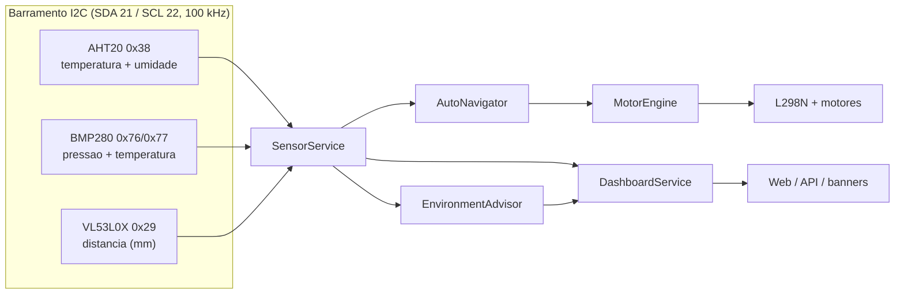
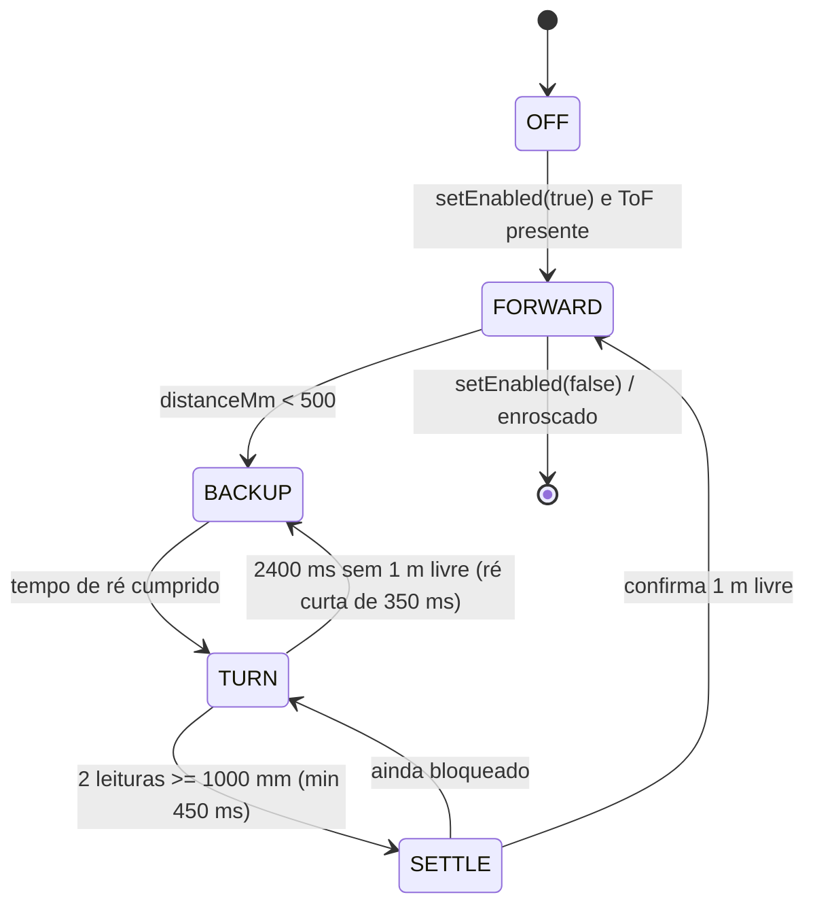

# iRobot — Navegação autônoma e sensores ambientais

Documento de projeto do que foi implementado no firmware `firmware/irobot`:
sensores I2C, avisos ambientais, desvio de obstáculos e as decisões de
engenharia por trás deles. Para uso rápido (ligação, comandos, API) consulte
[`firmware/irobot/README.md`](../firmware/irobot/README.md).

---

## 1. Visão geral



- `SensorService`: única dona do barramento; faz leitura escalonada e sem
  bloqueios longos. Tudo o que é ambiente/distância passa por ele.
- `AutoNavigator`: máquina de estados que consome `distanceMm()` e comanda o
  `MotorEngine` (inclusive pivô).
- `EnvironmentAdvisor`: histórico de pressão e de temperatura, gera avisos.
- `DashboardService`: expõe tudo em HTTP e serve a interface embarcada.

---

## 2. Sensores

### 2.1 Ligação

| Sensor | Pino do módulo | ESP32 | Observações |
|--------|----------------|-------|-------------|
| AHT20 | VCC / GND / SDA / SCL | 3V3 / GND / GPIO21 / GPIO22 | endereço fixo `0x38` |
| BMP280 | VCC / GND / SDA / SCL | 3V3 / GND / GPIO21 / GPIO22 | endereço `0x76` com SDO em GND, `0x77` com SDO em 3V3 |
| VL53L0X | VIN / GND / SDA / SCL | 3V3 / GND / GPIO21 / GPIO22 | montado na frente do chassi, apontando para o sentido de avanço |

Todo o barramento roda em **100 kHz**. O `VL53L0X` fica com `setTimeout(500)` e
`setMeasurementTimingBudget(20000)` (20 ms por medição).

### 2.2 Cadência

| Grandeza | Intervalo | Por quê |
|----------|-----------|---------|
| Ambiente (AHT20 + BMP280) | 2 s | sensores lentos; não precisa mais que isso para avisos |
| Distância em repouso | 400 ms | suficiente para exibir no painel sem gastar barramento |
| Distância com autônomo ligado | 80 ms | desvio precisa reagir rápido; alinhado ao timing budget de 20 ms |

O autônomo alterna a cadência via `SensorService::setFastDistance(bool)`, ligado
no `setEnabled(true)` e desligado ao parar, em `goStuck()` e ao sair do modo.

### 2.3 Tratamento de leituras inválidas

| Situação | Valor bruto | `distanceMm` | `lastRawMm` |
|----------|-------------|--------------|-------------|
| Alvo normal | 30–1200 mm | igual ao bruto | igual ao bruto |
| Sem alvo no alcance | ~8191 | `0` (livre) | 8191 |
| Timeout de leitura | — | mantém anterior | 9999 |

`distanceAgeMs()` marca quando foi a última `readRangeSingleMillimeters()`.
O `AutoNavigator` recusa amostra com mais de 500 ms (`AUTO_CLEAR_MAX_AGE_MS`),
o que evita concluir “caminho livre” com dado de antes do giro.

---

## 3. Navegação autônoma

### 3.1 Por que pivô e não arco

O chassi tem duas rodas motrizes e uma caster. No controle manual (`e`/`d`) uma
roda fica parada e a outra empurra: o robô gira em torno da roda parada, com a
caster arrastando. Em piso liso isso funciona, mas o arco é grande e a caster
derrapa.

No modo autônomo o giro é **pivô verdadeiro**: uma roda em ré e a outra em
frente, mesmo módulo de PWM (`moveDifferential(-s, s)`). O robô gira quase no
lugar, o que permite medir a folga com o ToF no mesmo ponto e reduz a chance de
“colar” na parede.

`MotorEngine::moveDifferential` também atualiza `_currentDir`/`_currentSpeed`
para a telemetria mostrar `esquerda`/`direita` coerentes com o pivô.

### 3.2 Máquina de estados



Regras que não estão óbvias no diagrama:

- **Alternância de lado**: a cada novo obstáculo o lado inicial do giro troca
  (`_side = (_avoidCount % 2 == 0) ? 1 : 0`). Se o giro não acha saída por dois
  segmentos seguidos, troca de lado no meio do processo.
- **Ré maior**: a cada 3 obstáculos a ré é de 800 ms em vez de 500 ms, para sair
  de cantos.
- **Giro sem saída**: ré curta de 350 ms (nudge) antes de continuar girando. Isso
  muda o ponto de medição sem gastar muito tempo.
- **SETTLE**: parar 250 ms e reconfirmar. Evita retomar o reto com uma leitura
  transitória (a caster ainda balançando, por exemplo).

### 3.3 Enroscado (stuck)

Contador `_avoidCount`:

- incrementa em cada obstáculo detectado no reto;
- incrementa em cada giro que termina sem achar 1 m livre (tentativa falha);
- zera após 2 s de avanço reto livre (`AUTO_FREE_FORWARD_MS`).

Com 100 tentativas seguidas (`AUTO_STUCK_ATTEMPTS`), o autônomo desliga, para os
motores e publica `stuck = true` + `stuckSeq` incrementado. O app mostra banner,
vibra, apita e, se permitido, dispara notificação do navegador.

### 3.4 Calibração

Sem encoder, o giro é por tempo e confirmado por distância. Se o robô girar de
menos:

1. aumentar `AUTO_TURN_MAX_MS` (mais tempo por segmento);
2. aumentar `AUTO_TURN_SPEED` (pivô mais forte, cuidado com corrente);
3. reduzir `AUTO_CLEAR_MM` se o ambiente tiver corredores estreitos.

Se girar demais ou “dançar” em espaço apertado:

1. reduzir `AUTO_TURN_MAX_MS`;
2. aumentar `AUTO_CLEAR_SAMPLES` (exigir mais confirmações de 1 m);
3. aumentar `AUTO_TURN_MIN_MS` para não avaliar durante o primeiro instante.

Se parar longe demais do obstáculo, reduzir `AUTO_STOP_MM`; se bater, aumentar.

### 3.5 Evidências de teste (bancada, COM9, ESP32-D0WDQ6)

Ambiente fechado (~15 cm de parede em todas as direções), autônomo ligado:

```text
Obstaculo 1/100 - re 500 ms, girando pela esquerda
[giro] dist=147 mm (bruto 147) livre=nao
[giro] dist=156 mm (bruto 156) livre=nao
Giro sem saida: recuando e continuando
Giro sem saida: trocando de lado
```

Leitura contínua durante o giro confirmada (`[giro]` a cada 500 ms com valor
bruto mudando). Em espaço aberto o giro encontra 1 m e passa por SETTLE antes de
voltar para FORWARD.

---

## 4. Avisos ambientais

### 4.1 Previsão de chuva (barômetro)

Regra clássica: o que importa é a **tendência**, não o valor absoluto.

- queda de 1–2 hPa em 3 h → piora do tempo, chuva provável em 6–12 h;
- queda > 2–4 hPa em 3 h → temporal se aproximando.

Implementação:

- 1 amostra de pressão por minuto, anel de 180 posições (3 h);
- `trend3h` = mais recente − mais antiga do anel (precisa de ≥ 30 amostras);
- `trend30m` = mais recente − amostra de 30 posições atrás (precisa de ≥ 31);
- aviso disparado quando:
  - `trend3h ≤ −1,0 hPa` **e** umidade ≥ 65 %, **ou**
  - `trend30m ≤ −0,6 hPa` **e** umidade ≥ 70 %;
- o aviso só é limpo quando a pressão volta a subir (3 h > −0,4 hPa e 30 min >
  −0,2 hPa), evitando piscar.

Antes de 30 min de histórico `trendReady = false` e o painel mostra “coletando
dados”. Com o sensor físico de chuva (FC-37) instalado, `rainSensor = true`
prevalece como “chuva agora”.

### 4.2 Conforto térmico e umidade

| Aviso | Liga | Desliga (histerese) |
|-------|------|---------------------|
| Calor | > 26 °C | < 25,5 °C |
| Frio | < 17 °C | > 17,5 °C |
| Ar seco | < 30 % UR | > 33 % UR |

As mensagens são acionáveis: “ligue o ar-condicionado”, “desligue o
ar-condicionado”, “beba água”.

### 4.3 Incêndio

Três gatilhos independentes:

1. temperatura absoluta ≥ 45 °C;
2. subida ≥ 4 °C dentro de 1 min (12 amostras a cada 5 s, compara com a menor da
   janela);
3. sensor de chama KY-026 abaixo do limiar (opcional).

O alerta é **latch**: permanece ativo até a temperatura cair 5 °C abaixo do
limite e a subida ficar abaixo de 1 °C/min. No app: banner vermelho fixo,
vibração longa, sirene (oscilador tipo sawtooth a 1,2 kHz) e notificação do
navegador se autorizada.

A heurística de temperatura detecta fogo próximo ao robô, não fumaça a distância.
Por isso o MQ-2 (fumaça/gás) está previsto como próximo sensor.

---

## 5. API e interface

### 5.1 Objeto `alerts`

Presente em `GET /api/sensors`:

| Campo | Tipo | Significado |
|-------|------|-------------|
| `rain` | bool | previsão de chuva (tendência + umidade) |
| `rainSensor` | bool | sensor físico molhado |
| `hot` / `cold` | bool | acima de 26 °C / abaixo de 17 °C |
| `dry` | bool | umidade abaixo de 30 % |
| `fire` | bool | incêndio (latch) |
| `trendReady` | bool | já há histórico suficiente |
| `trend3h` / `trend30m` | float | variação de pressão (hPa) |
| `tempRise` | float | maior subida de temperatura em 1 min (°C) |

### 5.2 Interface

- Painel `/`: cards Joystick, Comandos rápidos, Velocidade, Motores
  independentes, PWM, **Ambiente**, **Avisos**, Autônomo e Sistema.
- `/teste`: direcional compacto + linha de ambiente + linha de avisos + botão
  Autônomo.
- Banners `#alert-stuck` e `#alert-fire` (`.alert-critical`), com botão
  “Entendi” e reexibição apenas em novo evento (`stuckSeq`/transição de `fire`).
- Estado do app é atualizado a cada 1 s por `fetchSensors()`.

O `WebAssets.h` é gerado a partir de `web/`:

```text
powershell -ExecutionPolicy Bypass -File tools/generate_web_assets.ps1
```

---

## 6. Robustez de alimentação

Sintoma observado no Protótipo-67: no USB o AP subia e ficava estável; na
bateria (2S 7,4 V) o AP não aparecia. Causa: pack fraco — a partida dos motores
derrubava a tensão e o ESP32 reiniciava (brownout). Após recarregar o pack o
sistema passou a funcionar.

Mitigações já no firmware:

- GPIO27 e GPIO14 em LOW na primeira linha do `setup()`;
- `WiFi.setSleep(false)` (evita queda de throughput do AP);
- `WiFi.setTxPower(WIFI_POWER_11dBm)` (menos pico de corrente);
- log do motivo do reset (`esp_reset_reason`) e aviso explícito de BROWNOUT;
- log de saúde a cada 10 s: `heap`, `minHeap`, `clientesWiFi`, `auto`, `dist`;
- mDNS sem registro duplicado.

Mitigações de hardware recomendadas:

- buck 5 V dedicado ao ESP32 (não usar a saída 5 V do L298N);
- 1000 µF + 100 nF no VIN;
- pull-down de 10 kΩ em GPIO27/14;
- pack 3S (11,1 V).

---

## 7. Monitor de bateria (planejado, não implementado)

Divisor resistivo do positivo do pack para `GPIO35` (ADC1):

- R1 = 100 kΩ (pack → nó), R2 = 33 kΩ (nó → GND);
- fator 4,03×; fundo de escala ≈ 13,3 V com atenuação 11 dB;
- 100 nF opcional entre o nó e GND;
- consumo ≈ 95 µA;
- para pack 4S usar R2 = 22 kΩ.

Uso previsto: `batteryV` em `/api/sensors` e aviso “bateria fraca” abaixo de
~6,9 V (2S) reutilizando o banner do app. Não usar GPIO35 para outra coisa.

---

## 8. Checklist de teste

1. `tools/flash.ps1 -Sketch irobot -DetectOnly` → porta + chip corretos.
2. Boot: motivo do reset impresso, sem motores girando, AP `Irobot-Setup` no ar.
3. `/` e `/teste` abrem; ambiente atualiza a cada 1 s.
4. `m` no serial: temperatura, umidade, pressão, distância bruta e linha de
   avisos.
5. `a`: autônomo liga; em obstáculo a 50 cm para, dá ré, gira em pivô e só
   retoma com 1 m livre.
6. Cercar o robô: após 100 tentativas o app mostra “Robô enroscado”.
7. Aquecer o sensor acima de 26 °C (ou soprar) e conferir o aviso de calor;
   resfriar abaixo de 17 °C para o aviso de frio.
8. Abafar a umidade para < 30 % e conferir o aviso de beber água.
9. Aproximar uma chama/ponto quente do sensor e conferir banner de incêndio,
   vibração e sirene.
10. Comparar `trend3h` com um barômetro de referência após 30 min.
